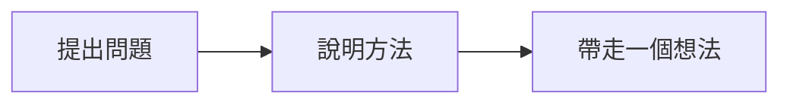

# Marp 撰寫指南

[English](../references/marp.md) · [臺灣華語 README](../README.zh-TW.md)

使用 `slides.md`，在開頭加入 YAML frontmatter，以 `---` 分隔投影片。
投影片 Markdown 重複使用 `#` 標題很正常，不套用部落格的標題或 metadata 規則。
頁數以 Marp 解析結果為準，不能靠比對水平線的正規表示式計算；
frontmatter、程式碼區塊、備註與分隔線都需要正確解析。

```markdown
---
marp: true
theme: ras
size: 16:9
paginate: true
title: 我的演講
---

<!-- _class: statement -->
# 一次說清楚一個想法。

<!-- 在這裡停一下，請觀眾舉一個例子。 -->

---

<!-- _class: image -->

```

範例圖片路徑需要替換成自己提供的素材。

可用的主題 class 包括 `title`、`section`、`statement`、`image`、`code`、`compare` 與 `closing`。
沒有 class 的投影片採用標題加內文版型。
`_class` 只影響當頁，`class` 會持續套用到後面的頁面。
CSS 主題以 `/* @theme ras */` 宣告，`theme.css` 由專案自行維護。

`.accent` 用於重點色，`.muted` 用於次要文字，`.credit` 用於圖片出處，
`.label` 用於圖表或框線上的小標籤（字級門檻比照 `minCreditSize`），
`.columns` 用於兩欄比較。這些已知的本機版型可以使用原始 HTML；
一般文字、清單、表格與程式碼仍採 Markdown。
文字太多時，優先縮短句子或拆頁，避免一味縮小字體。不要另創色彩 token 或 metadata 語法。

標示文字與位置依[圖片權利與標示](image-rights-zh-tw.md)；在投影片上以 `.credit` 呈現。

HTML 註解會成為講者備註，除非 Marp 將它辨識為指令。
備註內容避免包含 `-->`；示範 HTML 註解語法時，請放進 fenced code block。
編輯後要確認備註仍對應正確頁面。

在可編輯的 `slides.md` 保留 Mermaid 程式碼區塊：

````markdown

````

建置時，固定版本的 Mermaid CLI 與瀏覽器會將區塊轉成專案內的 SVG，
再以一般圖片引用放進產生的來源。既有 SVG 與截圖放在 `assets/`。
純文字 ASCII 圖使用 `text` 程式碼區塊；彩色 ASCII 圖可用已跳脫特殊字元的
`<pre class="ascii">` 搭配色彩 span。

圖片等素材放在 `assets/`。檔名含空格時，使用合法的 Markdown URL 跳脫或角括號。
建置會複製固定版本的拉丁字型與 Noto Sans TC Variable，並保留授權。
起始主題以 `RAS CJK` 作為臺灣華語內文、標題與程式碼註解的後備字型。
Mermaid 先載入標籤字型再計算版面，並將需要的字型子集內嵌至 SVG，支援離線使用。

其他文字系統或自訂品牌字型，請將字型與授權放入 `assets/`，在 `theme.css` 宣告並檢視實際畫面。
簡報必要的媒體與字型使用本機資源。來源引用可以使用 HTTP 連結；
繪製時需要連線載入的遠端資源會被離線檢查攔下。

初版輸出 HTML、PDF、備註與 PNG 預覽，不保證可編輯的 PowerPoint 輸出，
也不保證任意 HTML 都能無損轉成 Marp。

## 參考簡報轉換

使用者要求局部轉換時，先讀原始檔與截圖，保留文字、揭露順序、備註、程式碼、
圖片出處與原本的視覺層次。在 `sources.md` 記錄頁面對照。
過時的主張另外提出，不在格式轉換時默默改寫。

轉換既有簡報時，先看目前的 profile 是否說明了該簡報的舊格式。

## 標示程式碼重點

若要在程式碼區塊中框出該頁正在教的部分，在 fence 加上 `box` 這個字，
並用 `«` 與 `»` 包住要框的片段：

````markdown
```python box
result = «fetch(url, retries=3)»
```
````

建置時會先移除標記，讓 Marp 照常上色，再把框放回被標記的字元外圍。
語法上色會保留，寬度過大時 `<pre>` 仍會縮小。只有資訊字串含 `box` 的 fence
會被處理，其他 fence 的輸出與以往完全相同。不再需要在 `<pre>` 裡手寫 `<mark>`。

- 同一行內的範圍會變成行內框 `<mark class="box">`，只框住那段文字，
  例如整個呼叫，或單獨一個 `retries=3`。
- 跨越換行的範圍會變成區塊框 `<span class="box-block">`，以整行為單位，
  從第一行行首框到最後一行行尾。區塊框用 outline 繪製，不占版面，
  所以加框之後程式碼的每一行都不會移位。
- 同一個區塊可以有多個範圍，但範圍不可巢狀。
- 要在 `box` fence 中顯示字面的 `«` 或 `»`，請連寫兩個：`««` 與 `»»`。
  標記由左到右讀取，連續兩個相同字元一律視為字面，所以 `«x»»` 不是在 `x` 後結束範圍；
  標記與同類字面字元之間請隔一個字元。
- `«` 未關閉、多出的 `»`、巢狀的 `«` 與空的 `«»` 都會讓建置失敗，
  訊息為 `Box code block at source line N (first line: "…")` 加上原因。

框線顏色是 `var(--accent)`，沒有定義時用 `#ffb32d`，樣式來自套件樣式
（`scripts/kit.css`）。建置時會附加在 `theme.css` 之後，因此
`ras upgrade` 會把樣式與引擎送進既有簡報，不會動到簡報自己的主題。
`theme.css` 中有同名規則也無妨。

要在截圖上框出區域，把圖片放進 `<span class="hlin">`，每個框加一個
`<span class="hl">`，位置以圖片的百分比表示：

```html
<span class="hlin"><span class="hl" style="left:12%;top:30%;width:25%;height:8%"></span></span>
```

用任何檢視或編輯工具量出區域在圖片本身的像素座標，再換算：`left` = x ÷ 圖片寬度，
`top` = y ÷ 圖片高度，`width` 與 `height` 同理，各乘以 100。不要沿用 `.shot`，
那是主題裡的截圖佔位框。請檢查渲染後的頁面：框沒有對準目標時，只有在那裡看得出來。
